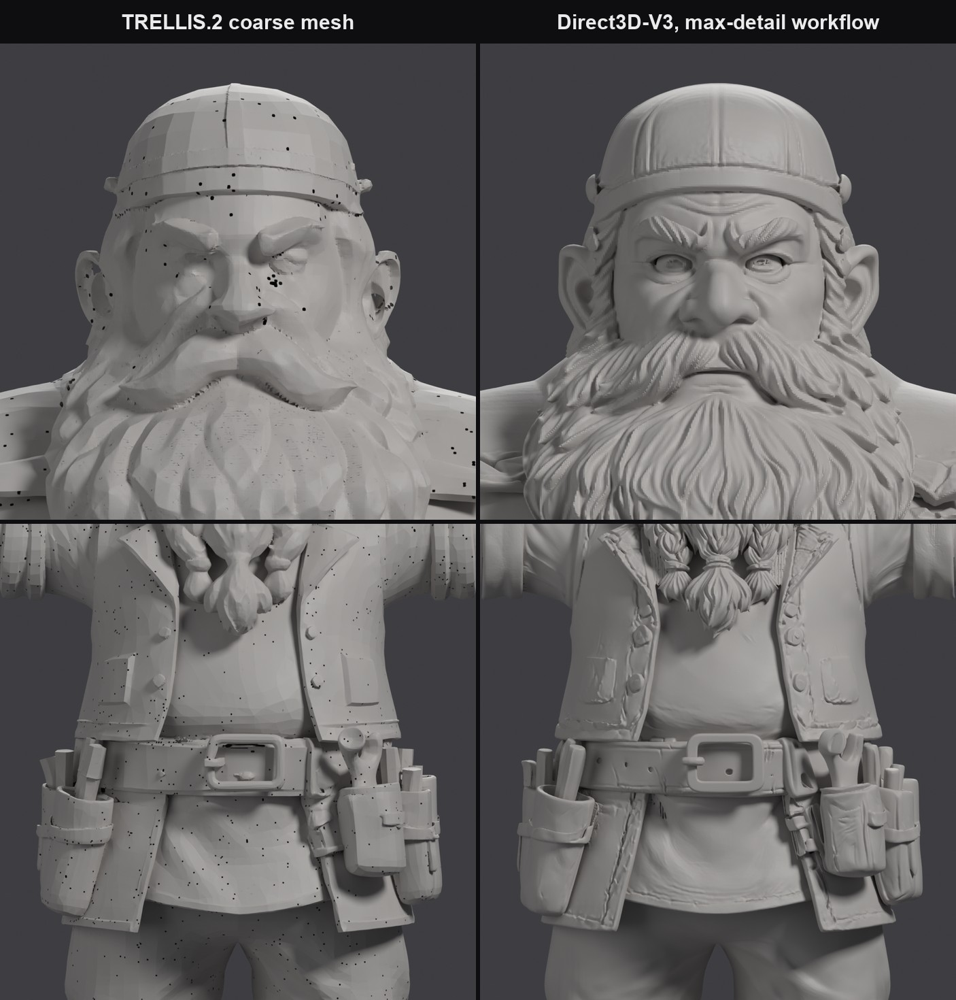
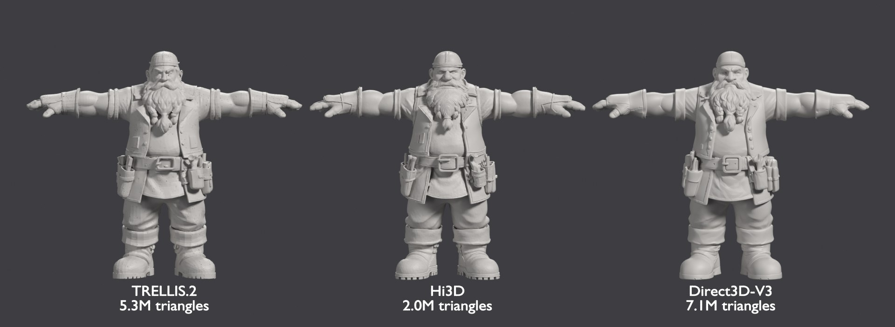
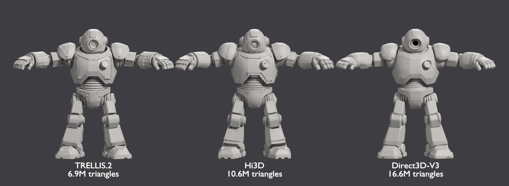
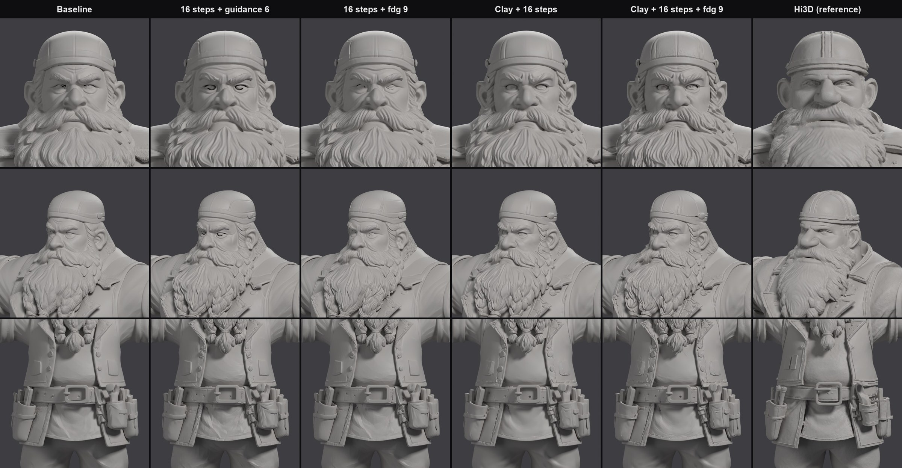
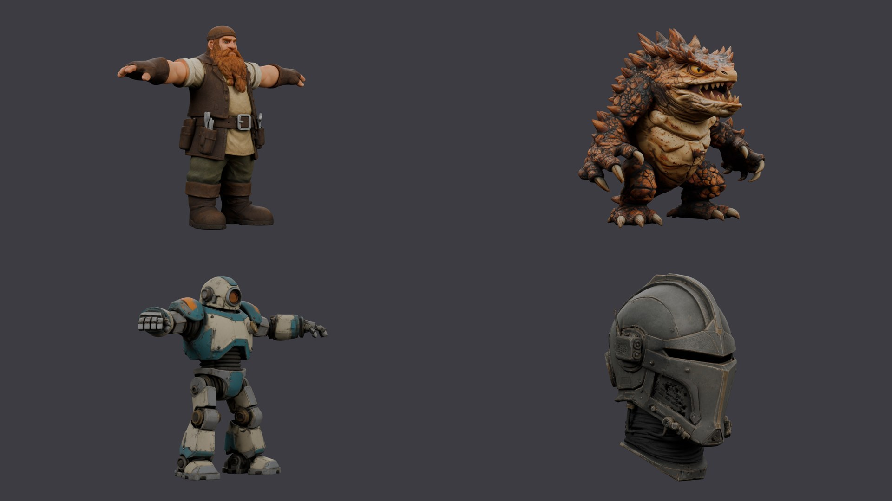

# Direct3D-V3 + UltraTex for ComfyUI - sharp, textured 3D models from one image

Turns **one image** into a **detailed, textured 3D model**, free and local in ComfyUI: TRELLIS.2 builds the coarse model, **Direct3D-V3** refines it at 1536, **UltraTex** paints it.

This pack is the installer and the workflows from my video. Everything here was measured on one PC: **RTX 5080 16 GB, 48 GB RAM, Windows 11, ComfyUI 0.45.4**. What was not tested is listed at the end; please read it.

## Which workflow?

All of them share one canvas: image > TRELLIS.2 > cleanup switch (WTiVo or remesh twice) > Direct3D-V3 > 3D previews > UltraTex texture stage. Do not want a texture? Select groups 7 to 9 and bypass them.

| Workflow | What is different |
|---|---|
| **PixelArtistry_Direct3D_01_Default** | The standard pipeline: WTiVo cleanup, Direct3D-V3 cascade with 16 steps, UltraTex texture. **Start here.** |
| **PixelArtistry_Direct3D_02_Max_Detail** | Most detail: clay version of your image as the reference (Qwen Image 2.1), raw coarse mesh, single stage, 16 steps, `fdg` guidance at 9. Needs the Qwen Image 2.1 models. |
| **PixelArtistry_Direct3D_03_Multiview** | Adds back, left and right images for Direct3D-V3. |
| **PixelArtistry_Direct3D_04_Low_Poly** | Decimates to 20,000 triangles before texturing: a game-ready character. |
| **PixelArtistry_Direct3D_05_Low_VRAM** | `max_tokens` at 75,000; the note lists the value per card size. |
| **PixelArtistry_Direct3D_06_Your_Mesh** | Refine a mesh that is already on disk. Direct3D-V3 only. |

> **State:** workflows 1 to 5 were assembled by script on 27 November. They **load in ComfyUI without missing nodes or errors, but have not been run yet** in this form. Their Direct3D-V3 part ran in the workflows they were built from; the texture stage with MostAadTech's UltraTex nodes is new here and untested.

The texture stage uses **MostAadTech's UltraTex Modular nodes** with GGUF models (FLUX.2 klein base 9B Q4_0, Qwen3-8B Q6_K): 10 views at 1024, baked at 2048, albedo only. On bigger cards, raise `view_resolution` to 2048 and `texture_size` to 4096.

Workflows 1 to 5 need Direct3D-V3, UltraTex Modular, ComfyUI-GGUF and WTiVo (all installed by this installer) plus **one node from [kijai/ComfyUI-KJNodes](https://github.com/kijai/ComfyUI-KJNodes)**, which this installer does not install because its requirements touch a package many other nodes share (OpenCV). Install it with ComfyUI Manager if ComfyUI reports it missing.

The image-to-3D part uses **ComfyUI's own TRELLIS.2 nodes** and their models.

## Results

Direct3D-V3 stays faithful to your image (faces, expressions, flat panels) and with default settings was 3 to 5 times faster than Hi3D on the same models (64 to 222 s against 5.5 to 16 minutes). Hi3D adds detail that is not in the image, repairs broken areas and gives a closed mesh. On a monster and a robot Hi3D was clearly ahead:

The textured models above were made with visualbruno's ComfyUI-UltraTex nodes, before the workflows moved to MostAadTech's UltraTex Modular nodes.

## Install (Windows)

1. Install [ComfyUI-Easy-Install](https://github.com/Tavris1/ComfyUI-Easy-Install) if you don't have it yet. Your ComfyUI must run **Python 3.12 with PyTorch 2.8 + CUDA 12.8**, with **Triton** installed (UltraTex needs it; the installer tells you if it is missing).
2. Install **64-bit Python 3.12** from [python.org](https://www.python.org/downloads/windows/) and keep "py launcher" ticked. Direct3D-V3 builds its own Python environment with it, so ComfyUI's packages stay untouched.
3. Request access to [DINOv3 ViT-H+](https://huggingface.co/facebook/dinov3-vith16plus-pretrain-lvd1689m) on Hugging Face (free, but needs an account). **Approval is manual and can take a while. Do this first.**
4. On this page: **Code > Download ZIP**. Unzip it into `ComfyUI-Easy-Install\Add-Ons\`.
5. Close ComfyUI and double-click `Install-Direct3D-V3-UltraTex.bat`.

Other portable installs: put the unzipped folder next to `python_embeded` and run the `.bat` there.

### What the installer does

- Checks the GPU, Python 3.12, your ComfyUI version and free disk space.
- Saves the package list of ComfyUI's Python before and after, and shows what was added.
- **Direct3D-V3 nodes** ([Mstafa-awad/Direct3D-V3_Comfyui_Nodes](https://github.com/Mstafa-awad/Direct3D-V3_Comfyui_Nodes), build of 26 November 2026): pinned commit, checked by SHA-256. Its own setup builds a private environment inside the node folder (about 7.6 GB) and downloads the INT8 weights (1.3 GB per stage) and DINOv3 (3.4 GB).
- **UltraTex Modular nodes** ([Mstafa-awad/UltraTex-ComfyUI-nodes](https://github.com/Mstafa-awad/UltraTex-ComfyUI-nodes)), **ComfyUI-GGUF** ([city96/ComfyUI-GGUF](https://github.com/city96/ComfyUI-GGUF)) and **WTiVo nodes** ([Mstafa-awad/WTiVo-WatertightVoxel-ComfyuiNode](https://github.com/Mstafa-awad/WTiVo-WatertightVoxel-ComfyuiNode)): pinned commits.
- Adds `trimesh`, `moderngl`, `glcontext`, `scipy`, `einops`, `psutil`, `threadpoolctl` and `gguf` to ComfyUI's Python **only if they are missing**. It does a dry run first and stops if pip would change a package you already have. It never installs or changes Triton; it tells you if Triton is missing.
- **UltraTex models:** FLUX.2 klein base 9B Q4_0 GGUF (5.2 GB), Qwen3-8B Q6_K GGUF (6.3 GB), FLUX.2 VAE (0.3 GB), UltraTex LoRA (0.5 GB) and decoder (0.1 GB), checked by SHA-256 where a checksum is known. Files that are already in `ComfyUI\models` are kept.
- Copies the workflows into `ComfyUI\user\default\workflows`. It never overwrites a workflow that is already there.
- Safe to run twice. Prints how to undo everything at the end.

Options: `Install-Direct3D-V3-UltraTex.bat NoModels` installs nodes and environments without downloading any model; `NoPause` runs without questions.

**WTiVo on RTX 20 / 30 / 40 cards:** the pack ships binaries for the RTX 50 series. On older cards, extract the "ForNonBlackwellgpu" archive inside its `build` folder, as its README describes.

## Linux

**The workflows cannot run on Linux today.** The Direct3D-V3 node pack is Windows-only: it ships a compiled Windows voxelizer and its setup refuses other systems. WTiVo ships Windows binaries too.

`install_ultratex_linux.sh` installs only the texturing half (UltraTex Modular nodes, ComfyUI-GGUF and their models) on Linux. **It has not been tested**, and I do not know whether the UltraTex Modular pack runs on Linux; its author developed and tested it on Windows. Read the script before you run it, and tell me in the issues what happened.

## How much VRAM

VRAM used by the Direct3D-V3 step alone. It follows the size of the model (the token count), not the resolution setting.

| Run | Tokens | VRAM reserved by Direct3D-V3 | RAM |
|---|---|---|---|
| Small character | 77,000 | 7.7 GB | 13.6 GB |
| Robot | 106,000 | 9.5 GB | 17.4 GB |
| Large model at the limit | 169,000 | 13.6 GB | 21.6 GB |
| 12 GB software limit, `max_tokens` 120,000 | 120,000 | 10.3 GB | 18.3 GB |
| 8 GB software limit, `max_tokens` 75,000 | 74,000 | 7.4 GB | 13.4 GB |
| 6 GB software limit, `max_tokens` 50,000 | 49,000 | 5.9 GB | 11.9 GB |

The limits were held by a second program on my 16 GB card. That is a software limit, **not a real smaller card**. Lowering `max_tokens` scales big models down, so they lose detail. With TRELLIS.2 in the same run, system RAM peaked at 42 to 45 GB of my 48 GB.

**Not measured yet:** TRELLIS.2 under a limit, and the texture stage with the UltraTex Modular nodes. Its author reports an 8 GB RTX 5050 laptop card; that is his number, not mine.

## Settings that matter

| Setting | Value | Why |
|---|---|---|
| `max_tokens` + `token_fit` | 150,000, `shrink_to_fit` | The node's old default (50,000, preserve scale) refuses normal TRELLIS.2 meshes. This is also the VRAM dial. |
| `stage_mode` | `single_stage` for detail, `cascade` for a clean mesh | Cascade left 416 open edges instead of 34,282 on my test character, but simplified fine detail. |
| `steps` | 8, or 16 for maximum detail | 16 halved the loose pieces for almost double the time. 25 gave artefacts around the eyes. |
| `guidance_mode` | `fdg` with `fdg_high_scale` 9 for maximum detail | Slightly crisper at the same speed. |
| `accel_mode` | `lossless` | 2.8 times faster than `off`. `fast` was slower on my card. |

About the coarse mesh: a 512 mesh worked almost as well as a 1024 one, but the shapes must be there. Direct3D-V3 refines what the mesh has and does not rebuild what is missing. Cleaning the mesh first (remesh, WTiVo) gives a much cleaner result and needs less VRAM, and it costs some detail; on hard-surface models the raw mesh was sharper.

## What was tested, and what was not

Tested on the PC named above:

- All Direct3D-V3 numbers and images on this page, on ten models.
- The max-detail recipe as a workflow end to end from a fresh ComfyUI start (507 s for the whole job), in its earlier form without the texture stage.
- The installer on a clean folder with `NoModels`: see `docs/installer_test.md`.
- All six workflow files load in ComfyUI without missing nodes or errors.

Not tested:

- **The six workflow files as a run.** In particular the texture stage with the UltraTex Modular nodes has not run in these workflows.
- **The model downloads of this installer** (my PC already had every model).
- Any other GPU; real 6, 8 or 12 GB cards; a PC with 32 GB RAM or less; Windows 10; a first-time Hugging Face login.
- WTiVo on a card older than the RTX 50 series.
- The Linux script.
- The max-detail recipe on more than one character.

## Licences

- **This repository** (installer, my workflows, images): MIT, see `LICENSE`.
- **Direct3D-V3** code and weights (DreamTechAI) and the INT8 weights and nodes (Mstafa-awad): MIT.
- **DINOv3 ViT-H+** (Meta): DINOv3 License, gated. Not included; you download it with your own account.
- **UltraTex** (Yibo Zhang et al.): see the UltraTex project for its weights. **UltraTex Modular nodes** (Mstafa-awad): GPL-3.0.
- **ComfyUI-GGUF** (city96): Apache-2.0.
- **FLUX.2 klein base 9B** (Black Forest Labs; GGUF file by unsloth): **FLUX Non-Commercial License**. Not included. Read the licence yourself before you use the model or its results for paid work.
- **Qwen3-8B** (GGUF file by unsloth): Apache-2.0.
- **WTiVo** (Mstafa-awad): GPL-3.0-or-later.
- Workflows 1 to 5 include MostAadTech's support note; please keep it if you share them.

No model weights are in this repository. Every file is downloaded from its original publisher.

## Undo

1. Close ComfyUI.
2. In `ComfyUI\custom_nodes`, delete `ComfyUI-Direct3D-V3` (this also removes its environment and models), `comfyui_ultratex_modular` and `WTiVo-WatertightVoxel-ComfyuiNode`. Delete `ComfyUI-GGUF` only if no other workflow of yours uses it.
3. The installer lists the packages it added to ComfyUI's Python; remove them with `python_embeded\python.exe -m pip uninstall NAME` if nothing else needs them.
4. Optional: delete the UltraTex models in `ComfyUI\models` and the workflows it added.

## Credits

Direct3D-V3 by [DreamTechAI](https://github.com/DreamTechAI/Direct3D-V3). ComfyUI nodes for Direct3D-V3, acceleration, INT8 weights, multiview, UltraTex Modular and WTiVo by [MostAadTech](https://github.com/Mstafa-awad). UltraTex by Yibo Zhang et al. ComfyUI-GGUF by city96. TRELLIS.2 by Microsoft.
